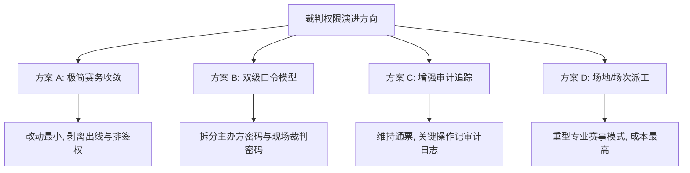

# 裁判权限模型与收窄方案探讨（交接底稿）

> **状态**：✅ **已落地完成（方案 B：双级口令模型全链路落地，后端/小程序/管理端/文档/测试均已交付闭环，回归测试 100% 通过）**  
> **议题来源**：全链路代码审查 §9-4（2026-09-22 初次讨论挂起，2026-10-17 再次确认维持挂起；2026-10-24 选定方案 B 实施方向，经边界业务拍板后完成全栈编码、集成测试与文档闭环）  
> **关联文档**：[[业务规则.md]] · [[API接口.md]] · [[数据库.md]] · [[审查与修复记录.md]] §4.4 · [[羽毛球裁判操作说明书.md]] · [[排球裁判操作说明书.md]]

---

## 1. 现状全景剖析（代码基线）

### 1.1 数据持久层模型

目前裁判权限体系基于两个极简的关系表（由 Flyway `V8__add_tournament_referee_access.sql` 创建）：

```sql
-- 1. 赛事级裁判密码配置（单赛事唯一）
CREATE TABLE `tournament_referee_config` (
  `id` VARCHAR(32) NOT NULL,
  `tournament_id` VARCHAR(32) NOT NULL,
  `password_hash` VARCHAR(128) NOT NULL,    -- BCrypt 哈希（P1-2 修复落地）
  `create_time` DATETIME NOT NULL,
  `update_time` DATETIME NOT NULL,
  PRIMARY KEY (`id`),
  UNIQUE KEY `uk_referee_config_tournament` (`tournament_id`)
);

-- 2. 用户级授权记录表（单赛事单用户唯一）
CREATE TABLE `tournament_referee_grant` (
  `id` VARCHAR(32) NOT NULL,
  `tournament_id` VARCHAR(32) NOT NULL,
  `user_id` VARCHAR(32) NOT NULL,          -- 已通过密码验证的用户 ID
  `create_time` DATETIME NOT NULL,
  PRIMARY KEY (`id`),
  UNIQUE KEY `uk_referee_grant_tournament_user` (`tournament_id`, `user_id`),
  KEY `idx_referee_grant_user_id` (`user_id`)
);
```

### 1.2 后端权限裁决架构

系统在业务层通过两个核心 Guard 类实现权限裁决：

```
                    ┌───────────────────────────┐
                    │  HTTP Request (Token)     │
                    └─────────────┬─────────────┘
                                  │
                                  ▼
                    ┌───────────────────────────┐
                    │      Controller 层        │
                    └─────────────┬─────────────┘
                                  │
           ┌──────────────────────┴──────────────────────┐
           ▼                                             ▼
┌──────────────────────────────┐              ┌──────────────────────────────┐
│    TournamentAccessGuard     │              │       MatchAccessGuard       │
│  (backend/.../tournament/)   │              │     (backend/.../match/)     │
├──────────────────────────────┤              ├──────────────────────────────┤
│ requireCreator()             │              │ requireMatchOperator()       │
│ requireCreatorOrReferee()    │              │ requireReportOperator()      │
│ hasRefereeGrant()            │              │ requireMatchReadable()       │
└──────────────────────────────┘              └──────────────────────────────┘
           │                                             │
           └──────────────────────┬──────────────────────┘
                                  ▼
               `tournament_referee_grant.selectCount`
             (单赛事只要存在该 user_id 记录，即判定拥有裁判权限)
```

1. **`TournamentAccessGuard`**（赛事/编排级）：
   - `requireCreator(userId, tournament)`：只校验 `userId == tournament.creatorUserId`。
   - `requireCreatorOrReferee(userId, tournamentId)`：满足以下任一即可放行：
     - 当前用户是赛事创建者；
     - `tournamentRefereeGrantMapper` 中存在 `(tournament_id, user_id)` 记录。
2. **`MatchAccessGuard`**（单场比赛/执裁级）：
   - `requireMatchOperator(userId, tournamentId)`：底层调用 `isOperator`（创建者 OR 已认证裁判）。
   - `requireReportOperator(userId, tournamentId)`：底层同样调用 `isOperator`。

### 1.3 权限矩阵对比表（现行行为）

| 接口 / 操作类别   | 具体端点 / 能力                                       | 仅创建者 |  授权裁判可否执行  | 匿名/普通访客 | 备注                        |
| ----------- | ----------------------------------------------- | :--: | :--------: | :-----: | ------------------------- |
| **赛事基础管理**  | 归档 / 取消归档 (`/archive`, `/unarchive`)            |  ✅   |     ❌      |    ❌    | 创建者独占                     |
|             | 修改裁判密码 (`POST /referee-password`)               |  ✅   |     ❌      |    ❌    | 改密同步吊销既有裁判（P2-2）          |
|             | 吊销某裁判授权 (`DELETE /referees/{uid}`)              |  ✅   |     ❌      |    ❌    | 移出 grant 表                |
|             | 编辑队伍 / 选手改名 (`PUT /teams/{id}`)                 |  ✅   |     ❌      |    ❌    | 未开赛时放行改名（P3-5）            |
|             | 修改排名规则判据 (`PUT /ranking-config`)                |  ✅   |     ❌      |    ❌    | 积分榜判据配置                   |
|             | 手写签表录入 (`PUT /draw-slots`)                      |  ✅   |     ❌      |    ❌    | 线下抽签重排                    |
|             | 手写分组录入 (`PUT /group-assignments`)               |  ✅   |     ❌      |    ❌    | 线下分组重排                    |
| **赛制推进与编排** | **修改小组出线资格覆盖 (`PUT /qualification-overrides`)** |  ✅   | **✅ 可以执行** |    ❌    | **§9-4 核心争议点①**           |
|             | **生成淘汰赛签表 (`POST /generate-knockout`)**         |  ✅   | **✅ 可以执行** |    ❌    | **§9-4 核心争议点②**           |
| **现场执裁与记分** | 获取单场独占锁 (`POST /lock`)                          |  ✅   |     ✅      |    ❌    | 互斥执裁锁                     |
|             | 实时记分 / 事件流上报 (`POST /events`)                   |  ✅   |     ✅      |    ❌    | 需携带 Lock-Token            |
|             | 阵容与轮次填写 (`PUT /lineup-config`)                  |  ✅   |     ✅      |    ❌    | 需携带 Lock-Token            |
|             | 结束单场比赛 (`PUT /finish`)                          |  ✅   |     ✅      |    ❌    | 计算胜者、推进下一轮                |
|             | 重新开始比赛 (`POST /restart`)                        |  ✅   | **✅ 可以执行** |    ❌    | **§9-4 争议点③：重置已完赛比分**     |
|             | 团体赛整场结算 (`POST /team-match/settle`)             |  ✅   |     ✅      |    ❌    | 判定团体总胜负                   |
| **战报与签署**   | 保存战报元数据 (`PUT /report-meta`)                    |  ✅   |     ✅      |    ❌    | 裁判姓名、挑边、备注                |
|             | 战报封存与归档 (`POST /report-seal`)                   |  ✅   |     ✅      |    ❌    | 封签后不可再改分                  |
| **信息读取**    | 赛事详情 / 赛程对阵 / 积分榜 / 战报                          |  ✅   |     ✅      | 🔓 开放读取 | 公开赛事全站可见                  |
|             | 查看裁判列表 (`GET /referees`)                        |  ✅   |     ✅      |    ❌    | `requireCreatorOrReferee` |

### 1.4 前端表现与感知

- **接口下发标志**：后端接口（如 `GET /tournaments/{id}/groups` 或 `bracket`）通过 `TournamentRefereeService.fillMatchAccess` 下发：
  - `refereeGranted: boolean`（当前用户是否已获得裁判授权）；
  - `canOperateMatches: boolean`（`isCreator || isReferee`，用于前端控制所有可操作按钮）。
- **页面交互入口**：
  - 在 `frontend/src/pages/tournament/groups.vue` 中，`canOperateMatches` 直接控制「确认出线名单」与「生成淘汰赛」按钮的显隐与点击权限。裁判认证后，与创建者一样能直接点击触发。
  - 在 `detail.vue`、`individual-record.vue`、`lineup.vue` 等页面中，若未认证裁判，点击执裁或签名时会弹出输入裁判密码的 Modal，校验成功后写入后端 `grant` 表并在本地缓存状态。

---

## 2. 问题定位与矛盾剖析（§9-4 的实质）

### 矛盾一：现场记分职责与赛事编排决策权的边界混淆
- **现场裁判的本职**：受命在指定场地记录特定场次的分数、轮次、发球权、违例、伤退，并签字确认该场比分真实有效。
- **现行系统的实现**：一旦输入裁判密码，裁判便获得了**赛事实体级别的超级权限**。不仅能执裁任何一场比赛，还能代表主办方：
  1. 人工指定谁从小组赛出线（`qualification-overrides` 强制覆盖积分榜规则计算结果）；
  2. 触发淘汰赛排签（`generate-knockout` 物化整张签表）；
  3. 重开已经完赛的比赛（`restart` 抹平比赛痕迹与后续晋级）。
- **反差对比**：裁判**不能修改排名判据**（`updateRankingConfig` 是创建者独占），却**能直接指定谁出线**。这在权限逻辑上存在轻度倒挂。

### 矛盾二：全局通票机制缺乏场次 / 场地隔离
- 现有 `tournament_referee_grant` 只有 `(tournament_id, user_id)`，没有 `court_id` 或 `match_id`。
- 只要主办方把密码告诉了某个裁判，该裁判就可以在小程序端打开本届比赛**任意场地、任意组别**的记分牌，甚至能抢其他正在执裁的裁判的锁（通过同账号顶锁或心跳过期接管机制）。

### 矛盾三：审计追踪与权责边界不清晰
- 数据库表 `tournament_qualification_override` 仅记录了 `operator_user_id`。
- 系统没有针对赛务操作的审计流水日志。一旦现场因出线资格或淘汰赛对阵产生争议（例如队伍质疑“为什么是我们被判出局”），后台无法直接证明该动作是“主办方决定”还是“某个裁判私自操作”。

---

## 3. 历史背景与为何持续维持挂起

在 2026-09-22 审查讨论与 2026-10-17 本次讨论中，均决定**维持挂起现状**，主要原因并非技术难度，而是**产品定位与民间赛事实际痛点的权衡**：

1. **目标客群与使用场景**：
   - Eunomia 系统定位为**校园院系杯赛、羽球/排球社团月赛、业余俱乐部对抗赛**；
   - 这类赛事通常只有 1~2 名核心组织者，组织者往往身兼参赛选手、现场调度、主裁判数职；现场裁判大多是现场拉来的熟人同学、免战轮次的选手。
2. **过度权限设计的现场灾难**：
   - 如果严格实行 RBAC（角色权限控制）或精细化场地派工：主办方必须在赛前给每个裁判分配场次、绑定微信；一旦现场临时换人数分、裁判手机没电、或主办方自己正在场上打球，赛程推进就会因为“权限不足”彻底卡死。
   - 现有的“一个赛事一个裁判密码”能让整个现场组织极其丝滑：主办方把 8 位数字密码发到裁判微信群，任何人扫码/输密即可上岗，主办方无暇顾及抽签时裁判直接在台前点“生成淘汰赛”把比赛接续下去。
3. **安全风险在目标场景内可控**：
   - 线下民间比赛有强烈的现场物理约束。裁判就坐在场边众目睽睽之下，恶意篡改他人比赛或私自改出线名单的行为在线下极易被当场识破；内部熟人赛事的信任半径天然大于商业公共系统。

---

## 4. 四种演进方案矩阵与对比

如果在新的上下文窗口中决定正式对裁判权限进行治理，以下是可选方案的技术推演与对比：



### 4.1 方案详细对比

| 方案 | 核心做法 | 改动成本 | 易用性影响 | 推荐度 |
|---|---|---|---|:---:|
| **方案 A：极简赛务收敛**（纯收紧） | - 将 `qualification-overrides` 与 `generate-knockout` 鉴权从 `requireCreatorOrReferee` 收紧为 `requireCreator`。<br>- 裁判仅保留：单场记分、换人/轮次、战报填报与封签、单场 restart。<br>- 前端 `groups.vue` 的出线与生成按钮改为仅创建者可见。 | **极低**<br>后端 2 处守卫<br>前端 2 处 `v-if` | 主办方必须亲自点出线和排签。若主办方在场上打球，需要短暂交手机或等下场。 | ⭐⭐⭐⭐<br>(最干净) |
| **方案 B：双级口令模型**（分权） | - 数据库 `tournament_referee_config` 增加 `role_type`（或增加 `master_password_hash`）。<br>- 密码分两级：**【赛务编排密码】**（可出线、排签、重开）与 **【现场执裁密码】**（仅记分、签名）。<br>- 小程序验证弹窗保持同一个，输入不同密码赋予不同 grant 权限。 | **中等**<br>需增加 Flyway 迁移<br>修改鉴权与前端展示 | 组织者可把“编排密码”给副手，“记分密码”给学生裁判，两全其美。 | ⭐⭐⭐⭐⭐<br>(最平衡) |
| **方案 C：维持现状 + 审计追溯**（软治理） | - 权限完全不动，裁判仍可排签和出线。<br>- 在 `tournament_qualification_override` 和赛程生成事件中记录操作者昵称与头像；并在详情页或战报中展示“由 [裁判昵称] 确认了出线结果”。 | **低~中**<br>加审计字段与 UI 展示 | 现场灵活性 100% 保留，通过透明化震慑私自操作。 | ⭐⭐⭐<br>(折中妥协) |
| **方案 D：场地/场次细粒度派工**（专业化） | - 增加 `match_referee_assignment` 表，将裁判账号精确分配到具体 `match_id` 或 `court_number`。<br>- 裁判只能持锁操作被派发给自己的场次。 | **高**<br>涉及整个赛程与裁判派发流程重构 | 现场操作极繁琐，对小型校园赛是负担。 | ⭐<br>(当前不建议) |

---

## 5. 新上下文窗口接手行动指南（Actionable Checklist）

如果新会话拍板实施，可直接根据选定方案按以下路径执行：

### 5.1 若选择【方案 A：极简赛务收敛】（最推荐，预计 1~2 小时）

1. **后端修改清单**：
   - 文件：`backend/src/main/java/com/scoring/backend/service/tournament/TournamentRankingService.java`
     - 行号约 155：`accessGuard.requireCreatorOrReferee(userId, tournament.getId())` 改为 `accessGuard.requireCreator(userId, tournament)`。
   - 文件：`backend/src/main/java/com/scoring/backend/service/impl/TournamentServiceImpl.java`
     - 行号约 628-630：`generateKnockoutForDivision` 中的校验从 `!isCreator && !hasRefereeGrant` 改为 `!isCreator`（只有创建者可以生成淘汰赛）。
2. **前端修改清单**：
   - 文件：`frontend/src/pages/tournament/groups.vue`
     - 修改 `canGenerateKnockout` 与 `canOpenKnockout` computed：将 `canOperateMatches` 替换为 `info.value?.creator === true`。
     - 确保普通裁判在小组赛页面可以看到晋级状态，但看不到“确认出线”与“生成淘汰赛”操作按钮。
3. **接口与文档同步**：
   - 更新 `docs/API接口.md` §5.10 与 §5.11：端点 20/21 权限标记从 `🔒 仅创建者或裁判` 明确改为 `🔒 仅创建者`。
   - 跑全量回归测试：`backend` mvn test（更新对应的权限断言用例即可）。

### 5.2 若选择【方案 B：双级口令模型】（详见第 6 章专章工程实施细案）

方案 B 已确认为当前首选演进路径。为确保后续 AI 或工程师能无缝接手进行权限边界裁决与细节编码，本方案对应的全链路扫描、数据库迁移规范、可行性与工时评估、粗略开发计划以及待评估边界清单，已于下文 **第 6 章** 完整展开。

---

## 6. 双级口令模型（方案 B）全链路代码扫描与技术可行性/工作量综合评估

### 6.1 方案 B 核心设计理念与三级角色模型

针对民间赛事实操中“既要防止普通裁判私自乱排签/改出线，又要避免主办方一人在场上比赛时赛务卡死”的实际矛盾，双级口令模型通过**将单一口令裂解为两个具备包含关系的权限口令**实现分权：

1. **`CREATOR`（赛事创建者/主办方）**：
   - 根凭证（通过 JWT 用户 ID 与 `creator_user_id` 比对）；
   - 独占能力：赛事归档与解档、修改/重置两级裁判口令、吊销已授权裁判、编辑队伍与选手改名、修改积分榜排名规则判据、删除赛事。
2. **`ADMIN`（赛务编排管理 / 编排副手）**：
   - 授权凭证：【赛务编排密码】（存储于 `admin_password_hash`）；
   - 定位：主办方信任的副手、检录台长、台前调度人员；
   - 核心能力：
     - **赛制编排决策**：修改小组出线资格覆盖（`PUT /qualification-overrides`）、预览淘汰赛（`POST /knockout-preview`）、物化并生成淘汰赛（`POST /generate-knockout`）；
     - **关键异常干预**：重开已完结比赛（`POST /restart`，见 6.8 待拍板议题）；
     - **全量现场执裁**：天然继承 `SCORER` 的全部比赛操作权限（抢锁、记分、换人、完赛、战报）；
     - **明确排除**：不可归档赛事、不可修改排名规则、不可修改裁判口令、不可踢除其他裁判。
3. **`SCORER`（现场执裁裁判 / 记分员）**：
   - 授权凭证：【现场执裁密码】（存储于既有 `password_hash`）；
   - 定位：被临时拉来协助在某块场地翻分、吹哨的普通裁判或免战选手；
   - 核心能力：
     - **单场互斥执裁**：获取单场执裁锁（`POST /matches/{id}/lock`）、心跳续期（`/heartbeat`）、主动释放（`/release`）；
     - **记分与事件流**：实时计分与事件上报（`PUT /events`）；
     - **赛前阵容与轮次**：排球/羽球阵容轮次配置（`PUT /lineup-config`、`PUT /team-lineup`、`PUT /team-items/{itemCode}/start`）；
     - **比赛结算与战报**：常规结束单场比赛（`PUT /finish`）、团体赛整场结算（`PUT /team-match/settle`）、战报填写与裁判签名封签（`PUT /report-meta`、`PUT /report-seal`）；
     - **严格收窄禁区**：**禁止** 触碰小组出线资格覆盖、**禁止** 生成淘汰赛、**禁止** 重开已完结比赛。
4. **`VISITOR`（普通访客/参赛选手）**：
   - 仅公开数据只读（赛程、对阵、积分榜、完赛战报）。

---

### 6.2 现有代码扫描全景清单（精确定位到文件、类、方法与关键行号）

本次全链路代码扫描覆盖数据库迁移、后端服务/守卫/控制器、前端小程序、Web 运营端及自动化测试。下表列出所有受影响或需协同改造的代码锚点：

| 分层 / 模块 | 文件路径 | 关键符号 / 行号 | 现行鉴权逻辑与职责 | 方案 B 预期改造动作 |
|---|---|---|---|---|
| **数据库迁移** | `backend/.../db/migration/V8__add_tournament_referee_access.sql` | L1-19 | 原始表定义（`tournament_referee_config`, `tournament_referee_grant`） | 作为建表历史基线参考 |
| **数据库迁移** | `backend/.../db/migration/V29__fix_restart_game_wins_trace.sql` | 全文 | 当前最新 Flyway 迁移脚本 | **新建 `V30__add_dual_referee_passcode.sql`**，加字段与默认值 |
| **实体定义** | `backend/.../entity/TournamentRefereeConfig.java` | L12-39 | 持久化实体，仅有单个 `passwordHash` | 增加 `adminPasswordHash` 映射与 getter/setter |
| **实体定义** | `backend/.../entity/TournamentRefereeGrant.java` | L12-34 | 持久化实体，`(tournament_id, user_id)` | 增加 `grantRole` 字段（默认 `SCORER`）与枚举映射 |
| **请求 DTO** | `backend/.../dto/TournamentRefereeAuthReq.java` | L5-17 | 仅携带 `password` 字段 | 保持入参不变（支持智能识别两套密码） |
| **请求 DTO** | `backend/.../dto/UpdateTournamentRefereePasswordReq.java` | L5-17 | 仅支持更新单个 `password` | 扩展为支持分别/同时更新 `scorerPassword` 与 `adminPassword` |
| **请求 DTO** | `backend/.../dto/CreateTournamentReq.java` | L65, L238-242 | 仅支持选填 `refereePassword` | 新增选填 `adminRefereePassword` 字段 |
| **响应 VO** | `backend/.../vo/TournamentRefereeAccessVO.java` | L5-25 | 仅返回 `granted: Boolean` 与列表 | 新增返回 `grantRole: String`（告知当前是 ADMIN 还是 SCORER） |
| **响应 VO** | `backend/.../vo/TournamentRefereeVO.java` | L3-18 | 裁判列表元素，无角色标识 | 增加 `grantRole: String`，展示谁是编排管理员、谁是普通裁判 |
| **响应 VO** | `backend/.../vo/TournamentMatchAccessVO.java` | L3-16 | 核心权限接口（`refereeGranted`, `canOperateMatches`, `canManageReferees`） | 保持既有字段兼容，**新增 `canManageKnockout: Boolean` / `refereeRole: String`** |
| **权限守卫** | `backend/.../tournament/TournamentAccessGuard.java` | L84-105 (`requireCreatorOrReferee`, `hasRefereeGrant`) | 仅判断 `count > 0` | 拆分 `hasAdminGrant` 与 `hasScorerGrant`；新增 `requireCreatorOrAdmin` 守卫 |
| **权限守卫** | `backend/.../match/MatchAccessGuard.java` | L29-43, L71-81 (`requireMatchOperator`, `isOperator`) | 仅查 `count > 0` 放行所有操作 | 保留 `requireMatchOperator` 放行记分；**新增 `requireMatchRestartOperator`** 仅放行 Creator 和 Admin |
| **架构异味修复** | `backend/.../impl/TeamMatchServiceImpl.java` | L668-683 (`requireOperator`) | **绕过 Guard**：直接手写 `tournamentRefereeGrantMapper.selectCount` | **重构收归**：改用 `MatchAccessGuard`，消除直接跨层查询 Mapper 异味 |
| **架构异味修复** | `backend/.../impl/MatchServiceImpl.java` | L482-487 (`canOperateMatch`) | **绕过 Guard**：直接手写 `tournamentRefereeGrantMapper.selectCount` | **重构收归**：改用 `MatchAccessGuard.isOperator` |
| **业务服务** | `backend/.../tournament/TournamentRefereeService.java` | L67-114 (`authenticateReferee`) | 单密码比对 + 单一授权插入 | **双密码智能逐级匹配**：先匹 admin 赋予 ADMIN，次匹 scorer 赋予 SCORER；**支持已授权 SCORER 静默升级为 ADMIN** |
| **业务服务** | `backend/.../tournament/TournamentRefereeService.java` | L145-178 (`updateRefereePassword`) | 改密后整表清空该赛事所有 grant | 支持按角色精细化改密；改密后精准吊销对应角色的 grants |
| **业务服务** | `backend/.../tournament/TournamentRefereeService.java` | L220-243 (`fillMatchAccess`) | 组装下发权限布尔值 | 下发 `refereeRole`、`canManageKnockout`（Creator/Admin 为 true，Scorer 为 false） |
| **业务服务** | `backend/.../impl/TournamentServiceImpl.java` | L591-594 (`previewDivisionKnockout`) | 校验 `!isCreator && !hasRefereeGrant` | 收紧为 `!isCreator && !hasAdminGrant` |
| **业务服务** | `backend/.../impl/TournamentServiceImpl.java` | L627-630 (`generateKnockoutForDivision`) | 校验 `!isCreator && !hasRefereeGrant` | 收紧为 `!isCreator && !hasAdminGrant` |
| **业务服务** | `backend/.../tournament/TournamentRankingService.java` | L151-155 (`updateQualificationOverrides`) | 校验 `requireCreatorOrReferee` | 收紧为 `requireCreatorOrAdmin` |
| **业务服务** | `backend/.../match/MatchSettlementService.java` | L468-470 (`restartMatchInternal`) | 校验 `requireMatchOperator` | 收紧为 `requireMatchRestartOperator`（避免普通记分裁判重开已完结场次） |
| **业务服务** | `backend/.../tournament/TournamentCreationFactory.java` | L720, L1419-1429, L1471-1478 | 仅落库执裁密码 | 同步支持落库可选的编排管理密码 `adminRefereePassword` |
| **控制器** | `backend/.../controller/TournamentController.java` | L241-264 | 裁判认证、列表、改密、移除端点 | 适配 DTO/VO 扩展字段 |
| **小程序页面** | `frontend/src/pages/tournament/groups.vue` | L115, L446, L533-546, L1401, L1441 | `canOperateMatches` 绑定出线与排签按钮 | 将排签与出线按钮鉴权从 `canOperateMatches` 拆出，绑定为 `canManageKnockout` |
| **小程序页面** | `frontend/src/pages/tournament/bracket.vue` | L227, L431-435 | 记分入口守卫 `guardOperateMatch` | 保持 `canOperateMatches` 即可（ADMIN 和 SCORER 均能执裁） |
| **小程序页面** | `frontend/src/pages/tournament/detail.vue` | L56-70, L263-275 | 裁判验证按钮、徽标、输入弹窗 | 徽标区分子标签（「裁判」 vs 「赛务管理」）；弹窗文案升级 |
| **小程序弹窗** | `frontend/src/components/RefereeAuthPopup.vue` | L1-158 | 执裁/签名时阻断弹出的验证框 | 保持轻量，输入任一口令均可放行后续动作 |
| **小程序创建** | `frontend/src/pkg-create/index.vue` & `volleyball.vue` | `refereePassword` 字段绑定 | 仅单个输入项 | 新增折叠/选填项「赛务管理密码（用于出线与编排管理）」 |
| **Web 管理端** | `web/admin-web/src/views/CreateTournamentView.vue` | L41, L613, L1617, L1760 | 仅单个 `refereePassword` 输入框 | 同步增加「赛务编排密码」可选输入框与格式校验规则 |
| **单元测试** | `backend/.../service/tournament/TournamentRefereeServiceTest.java` | L56-161 | 测试单密码认证与锁定 | 扩充测试双密码匹配、静默角色升级、失败锁定与改密吊销 |
| **集成测试** | `backend/.../controller/TournamentControllerIntegrationTest.java` | L1028-1150, L1427-1805 | 单角色下的接口全覆盖 | 扩充 ADMIN 成功排签、SCORER 排签报 403/400、SCORER 记分成功等场景用例 |

---

### 6.3 数据库改造方案与平滑迁移设计（Flyway V30）

系统当前最新 Flyway 迁移脚本为 `V29__fix_restart_game_wins_trace.sql`，因此新增迁移脚本应为 **`V30__add_dual_referee_passcode.sql`**。

#### 6.3.1 DDL 迁移脚本定义

```sql
-- V30__add_dual_referee_passcode.sql
-- 裁判体系双级口令改造：支持赛务编排管理密码与分级授权角色

-- 1. 赛事裁判配置表：增加赛务编排密码哈希字段（允许为空，为空时仅创建者可管理编排）
ALTER TABLE `tournament_referee_config`
  ADD COLUMN `admin_password_hash` VARCHAR(128) NULL DEFAULT NULL COMMENT '赛务编排管理密码哈希（BCrypt）' AFTER `password_hash`;

-- 2. 裁判授权明细表：增加授权角色字段（默认均为 SCORER 现场记分裁判）
ALTER TABLE `tournament_referee_grant`
  ADD COLUMN `grant_role` VARCHAR(16) NOT NULL DEFAULT 'SCORER' COMMENT '授权角色: ADMIN(编排管理) / SCORER(现场执裁)' AFTER `user_id`;

-- 3. 补充索引优化：为高频角色判定查询添加联合索引
ALTER TABLE `tournament_referee_grant`
  ADD INDEX `idx_referee_grant_tour_role` (`tournament_id`, `grant_role`);
```

#### 6.3.2 历史数据平滑兼容与升级策略
1. **历史 Grant 记录自动兼容**：
   - 迁移执行时，既有全部历史授权记录自动获得 `grant_role = 'SCORER'`，其单场记分、战报签署权限丝毫未损；同时其历史对排签和出线覆盖的非法渗透能力被自动、无缝地回收。
2. **历史赛事 Config 自动降级兼容**：
   - 历史赛事的 `admin_password_hash` 默认为 `NULL`。
   - 后端逻辑中明确约定：若 `admin_password_hash == null`，则该赛事未启用第三方编排密码，只有赛事创建者（`isCreator`）可以执行排签、出线与重开。**行为自然优雅降级为方案 A，不会产生任何空指针或死锁**。

---

### 6.4 认证交互、并发安全与角色升级机制

#### 6.4.1 单一入口智能鉴权算法（Smart Auth Pipeline）

为最大化保持前端小程序的简易性，**不强制**拆分两套弹窗，依然共用一个输入框（端点保持 `POST /api/v1/tournaments/{id}/referee-auth`，入参保持 `{ "password": "..." }`）。后端执行以下管道判别：

```mermaid
flowchart TD
    A[客户端提交 password] --> B{是否存在失败锁定?}
    B -- 是 (15分钟内错5次) --> C[抛 400 尝试次数过多]
    B -- 否 --> D{该赛事是否配置了 admin_password_hash?}
    D -- 是 --> E{比对 admin_password_hash}
    E -- 匹配成功 --> F[认定角色: ADMIN]
    E -- 匹配失败 --> G{比对 password_hash (Scorer)}
    D -- 否 --> G
    G -- 匹配成功 --> H[认定角色: SCORER]
    G -- 匹配失败 --> I[记录失败次数 passwordFailures.recordFailure]
    I --> J[抛 400 裁判密码错误]
    F --> K{检查用户既有 grant 记录}
    H --> K
    K -- 无记录 --> L[新增 INSERT: role = targetRole]
    K -- 已是 SCORER, 当前是 ADMIN --> M[晋升 UPDATE: grant_role = 'ADMIN']
    K -- 角色级别无需变动 --> N[幂等放行]
    L --> O[清空失败计数 + 返回 VO 含当前 role]
    M --> O
    N --> O
```

#### 6.4.2 角色晋升与并发兜底机制
- **静默晋升（Promotion）**：现场裁判在场边记分（已认证为 `SCORER`），随后受主办方委托前往检录台处理抽签，在小组赛页面输入了编排密码。此时系统检测到 `existing.grantRole == 'SCORER' && targetRole == 'ADMIN'`，直接就地执行 `update grant_role = 'ADMIN'`，无需先解绑再认证。
- **防降级保护（No Demotion）**：若用户已是 `ADMIN`，若后续误输入了普通裁判密码，系统判定其已有更高权限，直接放行保持 `ADMIN`，不会被恶意或无意降级。
- **唯一键幂等与并发**：表层维持 `UNIQUE KEY uk_referee_grant_tournament_user (tournament_id, user_id)`，并发冲突捕获 `DuplicateKeyException` 并转为安全查验。

---

### 6.5 技术可行性全维度评估（Feasibility）

1. **架构契合度（极高 ⭐⭐⭐⭐⭐）**：
   - 后端已建立无状态的 Guard 体系（`TournamentAccessGuard` 和 `MatchAccessGuard`），只需要在 Guard 层新增一个 `hasAdminGrant` 并在出线/排签处换用 `requireCreatorOrAdmin` 守卫，业务控制器代码几乎无需翻新；
   - 密码哈希存储全部复用现有 Hutool `BCrypt` 工具，安全标准与用户密码统一。
2. **向后兼容性（完全无损 ⭐⭐⭐⭐⭐）**：
   - 老版小程序与 Web 端依赖的布尔字段 `refereeGranted` 和 `canOperateMatches` 保持原口径（只要是 Referee 均返回 true），存量记分牌与战报编辑流程不受任何破坏；
   - 新增布尔字段 `canManageKnockout` 或 `refereeRole` 供新版前端控制高级按钮的显隐。
3. **潜在风险点与防范对策**：
   - **风险 1：两套密码被主办方设为相同**  
     *对策*：在创建或修改密码时，校验 `adminPassword` 与 `refereePassword` 不可完全一致；若一致直接抛出参数异常拦截。
   - **风险 2：架构遗留的 Bypass Guard 漏洞**  
     *对策*：本次扫描排查出 `TeamMatchServiceImpl.requireOperator` 与 `MatchServiceImpl.canOperateMatch` 绕过了 Guard 直接查库。必须在 Phase 2 将它们统一收拢至 Guard，严禁业务服务层私自直连 `tournamentRefereeGrantMapper`。
   - **风险 3：改密吊销范围扩大导致现场骚乱**  
     *对策*：提供精细化改密接口。修改编排密码仅吊销 `ADMIN` 授权，不影响正在场上挥汗计分的普通裁判；修改执裁密码才吊销 `SCORER`。

---

### 6.6 模块级工作量精细评估（Workload Breakdown）

经对扫描到的全量代码进行逐点核算，方案 B 的预计开发工作量分解如下：

| 序号 | 改造模块 | 涉及关键文件 | 详细工作项 | 预估工时 |
|:---:|---|---|---|:---:|
| **1** | **数据持久层** | `V30__add_dual_referee_passcode.sql`, `TournamentRefereeConfig.java`, `TournamentRefereeGrant.java` | 编写 Flyway 脚本、更新两张表的实体类字段、添加 `RefereeGrantRole` 枚举 | **0.5 小时** |
| **2** | **守卫层重构** | `TournamentAccessGuard.java`, `MatchAccessGuard.java` | 增加 `hasAdminGrant` / `requireCreatorOrAdmin` / `requireMatchRestartOperator`；重构消除 `TeamMatchServiceImpl` 与 `MatchServiceImpl` 的直连查库异味 | **1.5 小时** |
| **3** | **认证与服务层** | `TournamentRefereeService.java`, `TournamentCreationFactory.java` | 编写双密码比对算法、角色静默升级、精细化改密与吊销、创建赛事支持双密码校验落库 | **2.0 小时** |
| **4** | **业务权限切分** | `TournamentServiceImpl.java`, `TournamentRankingService.java`, `MatchSettlementService.java` | 排签收窄至 Admin、出线覆盖收窄至 Admin、比赛 restart 收窄至 Admin/Creator | **1.0 小时** |
| **5** | **VO 与契约同步** | `TournamentMatchAccessVO.java`, 各 VO 实现类, `docs/API接口.md`, `docs/数据库.md` | 下发 `canManageKnockout` 与 `refereeRole`；严格遵守 §10-7 同步更新 API 文档与数据库字典 | **1.0 小时** |
| **6** | **小程序前端** | `groups.vue`, `detail.vue`, `RefereeAuthPopup.vue`, `pkg-create/` | `groups.vue` 按钮解绑与独立受控、详情页徽标分级显示、创建赛事增加编排密码配置项 | **1.5 小时** |
| **7** | **Web 管理端** | `CreateTournamentView.vue` | 赛事创建页增加「赛务编排密码」可选表单项及规则校验 | **0.5 小时** |
| **8** | **测试体系回归** | `TournamentRefereeServiceTest.java`, `TournamentControllerIntegrationTest.java` | 编写双口令单元测试、角色晋升测试、越权排签拒绝拦截测试、跑通全量混沌测试回归 | **1.5 小时** |
| **合计** | **全链路端到端** | **跨越后端、前端、Web端、文档与测试共计 20+ 文件** | **完整端到端交付与回归测试** | **约 9.5 小时<br>(~1.2 人天)** |

---

### 6.7 粗略实施路线图与编码开发步骤（Phased Roadmap）

```
┌────────────────────────────────────────────────────────────────────────┐
│  Phase 1: 基础设施与数据持久层 (Flyway V30 + Entity + Enum)             │
└───────────────────────────────────┬────────────────────────────────────┘
                                    │
┌───────────────────────────────────▼────────────────────────────────────┐
│  Phase 2: 访问守卫收拢与重构 (Access Guards & Eliminate Bypass Code)   │
└───────────────────────────────────┬────────────────────────────────────┘
                                    │
┌───────────────────────────────────▼────────────────────────────────────┐
│  Phase 3: 业务分权与智能认证落地 (RefereeService + Split Business Ops)  │
└───────────────────────────────────┬────────────────────────────────────┘
                                    │
┌───────────────────────────────────▼────────────────────────────────────┐
│  Phase 4: API 契约与文档同步 (VOs + API接口.md + 数据库.md)             │
└───────────────────────────────────┬────────────────────────────────────┘
                                    │
┌───────────────────────────────────▼────────────────────────────────────┐
│  Phase 5: 多端适配 (Mini-Program groups/detail + Admin-Web)            │
└───────────────────────────────────┬────────────────────────────────────┘
                                    │
┌───────────────────────────────────▼────────────────────────────────────┐
│  Phase 6: 严密回归与测试验收 (Unit Tests + Integration Tests + Chaos)   │
└────────────────────────────────────────────────────────────────────────┘
```

1. **阶段一（Phase 1：数据底座）**：
   - 编写 `db/migration/V30__add_dual_referee_passcode.sql`；
   - 实体类与枚举类就位。
2. **阶段二（Phase 2：守卫重构）**：
   - `TournamentAccessGuard` 与 `MatchAccessGuard` 引入 `ADMIN` / `SCORER` 分流；
   - 消除 `TeamMatchServiceImpl` 与 `MatchServiceImpl` 中的绕路私查，收归统一守卫。
3. **阶段三（Phase 3：核心业务分权）**：
   - 实现 `TournamentRefereeService` 双密码流水线、角色晋升、改密精准吊销；
   - `TournamentRankingService` 出线覆盖收窄为 Admin；
   - `TournamentServiceImpl` 淘汰赛排签收窄为 Admin；
   - `MatchSettlementService` restart 比赛收窄为 Admin/Creator。
4. **阶段四（Phase 4：契约演进）**：
   - 扩展 `TournamentMatchAccessVO` 与 `TournamentRefereeVO`；
   - 同步更新 `docs/API接口.md` §10 章节端点契约。
5. **阶段五（Phase 5：前端与交互协同）**：
   - `groups.vue` 解除 `canOperateMatches` 对排签与出线覆盖的直接绑定，改为由 `canManageKnockout` 驱动；
   - `detail.vue` 优化裁判标签与验证提示；
   - 小程序与 Web 创建赛事页支持输入编排口令。
6. **阶段六（Phase 6：测试防护网）**：
   - 扩充单元测试与 MockMvc 集成测试；
   - 执行羽毛球/排球全生命周期混沌测试，验证千场无头仿真在分权改造后稳定性 100% 保持。

---

### 6.8 业务决策定稿与实际落地记录（Final Decisions & Deliverables）

在 2026-10-24 实施中，针对此前识别的 6 个开放决策点已完成全面拍板并全链路编码落地：

1. **决策点 1（单场重开比赛边界）**：
   - **定稿策略**：按比赛完赛状态一刀切切分。
   - **实现细节**：未完赛比赛（`status < 2`，含未开始/进行中）允许 `SCORER / ADMIN / CREATOR` 重开，保障场边裁判偶发手滑误触快速纠错；已完赛比赛（`status = 2` 或 `3`）仅允许 `ADMIN / CREATOR` 重开，防止普通裁判私自抹掉已推进的晋级树（400 提示『已完赛的比赛仅赛务管理员或创建者可重开』）。
   - **契约下发**：`MatchRecordDetailVO` 与 `TeamMatchLineupVO` 均新增下发 `canRestartMatch: boolean`。

2. **决策点 2（创建时双口令约束与防撞）**：
   - **定稿策略**：双口令选填，强制不同。
   - **实现细节**：创建赛事时 `refereePassword` 与 `adminRefereePassword` 均为 8~12 位数字选填项；若启用 `adminRefereePassword`，必须同时设置 `refereePassword`，且两级密码明文不可相同。单项修改密码时通过 `BCrypt.checkpw` 进行反向跨级撞车拦截。若未设置编排密码，系统自然退化为创建者独占编排管理（方案 A 行为）。

3. **决策点 3（改密精准吊销与执裁清锁）**：
   - **定稿策略**：精细隔离 + 撤权清锁。
   - **实现细节**：修改现场执裁密码仅吊销 `grant_role = 'SCORER'` 记录；修改赛务编排密码仅吊销 `grant_role = 'ADMIN'` 记录。吊销授权或移除裁判时，系统同步调用 `match_record` 更新逻辑，清空被撤权用户在该赛事下持有的所有未释放执裁锁（`locked_by_user_id` / `lock_token` / `lock_expire_time` 置 NULL），杜绝僵尸会话越权写分。

4. **决策点 4（战报封签修改）**：
   - **定稿策略**：维持现状，不增加解除封签能力。

5. **决策点 5（前端交互与 Toast 明确感知）**：
   - **定稿策略**：明确区分 + 升级入口不封死。
   - **实现细节**：输入密码后，后端统一识别返回 `grantRole`（`ADMIN` / `SCORER`）；前端按角色分别 Toast「已获得赛务管理权限（可出线与排签）」与「已获得现场执裁权限」。详情页分别展示橙色「赛务管理」与绿色「裁判员」徽章。当用户仅具备 `SCORER` 权限时，点击详情页徽章或点击小组赛出线/排签按钮，均可唤起输入框补输编排密码原地晋升为 `ADMIN`；若误输普通执裁密码则提示「该操作需要赛务编排密码，当前仍为现场执裁权限」。

6. **决策点 6（裁判列表查看权限）**：
   - **定稿策略**：收窄至仅创建者与 ADMIN。
   - **实现细节**：`GET /api/v1/tournaments/{id}/referees` 权限守卫由 `requireCreatorOrReferee` 收紧为 `requireCreatorOrAdmin`，普通现场裁判（`SCORER`）调会被拒绝（400），杜绝普通裁判查阅全体裁判名单与角色信息。

---

### 6.9 验证与全栈交付清单

- **数据库与迁移**：
  - `backend/src/main/resources/db/migration/V30__add_dual_referee_passcode.sql`：一版写全、规范落盘；
  - `backend/src/main/resources/schema-h2.sql`：集成测试内存库结构同步更新。
- **后端实体/DTO/VO/服务/守卫**：
  - 实体：`TournamentRefereeConfig`、`TournamentRefereeGrant`（增加角色常量与字段）；
  - DTO：`CreateTournamentReq`、`UpdateTournamentRefereePasswordReq`；
  - VO：`TournamentRefereeAccessVO`、`TournamentRefereeVO`、`TournamentMatchAccessVO`（及其实现类 GroupsVO/BracketVO/DetailVO）、`MatchRecordDetailVO`、`TeamMatchLineupVO`；
  - 守卫：`TournamentAccessGuard`、`MatchAccessGuard`（收拢直接查询 Mapper 的代码异味）；
  - 业务层：`TournamentRefereeService`、`TournamentCreationFactory`、`TournamentServiceImpl`、`TournamentRankingService`、`MatchSettlementService`、`MatchServiceImpl`、`TeamMatchServiceImpl`。
- **前端与运营台**：
  - 小程序：`detail.vue`、`groups.vue`、`bracket.vue`、各战报页（`individual-record.vue` 等）、`pkg-create/index.vue`、`pkg-create/volleyball.vue`；
  - Web 运营端：`web/admin-web/src/views/CreateTournamentView.vue`。
- **文档与测试**：
  - 同步更新 `docs/API接口.md` 与 `docs/数据库.md`；
  - 单元测试与 MockMvc 集成测试：`mvn test -Dtest='!*ChaosTest'` 全部 475 个测试通过；
  - 千场无头混沌仿真：`mvn test -Dtest='*ChaosTest'` 5 场全生命周期混沌测试 100% 通过；
  - 前端单测套件：`npx vitest run` 23 个测试文件、372 个测试用例 100% 全部通过。

---
*本文档经全链路实施落地并全量测试通过后定稿封存。*
