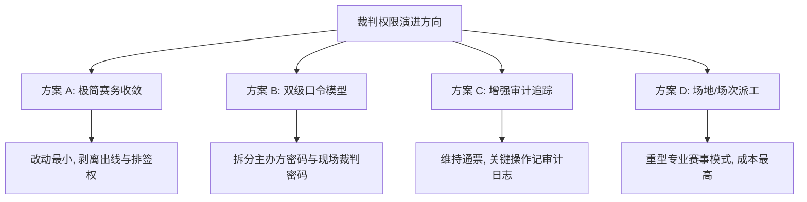

# 裁判权限模型与收窄方案探讨（交接底稿）

> **状态**：⏸ **挂起中（待业务拍板）**  
> **议题来源**：全链路代码审查 §9-4（2026-09-22 初次讨论挂起，2026-10-17 再次确认维持挂起，待后续在新上下文中独立讨论与实施）  
> **关联文档**：[[业务规则.md]] · [[API接口.md]] · [[数据库.md]] · [[审查与修复记录.md]] §4.4 · [[羽毛球裁判操作说明书.md]] · [[排球裁判操作说明书.md]]

---

## 1. 现状全景剖析（代码基线）

### 1.1 数据持久层模型

目前裁判权限体系基于两个极简的关系表（由 Flyway `V8__add_tournament_referee_access.sql` 创建）：

```sql
-- 1. 赛事级裁判密码配置（单赛事唯一）
CREATE TABLE `tournament_referee_config` (
  `id` VARCHAR(32) NOT NULL,
  `tournament_id` VARCHAR(32) NOT NULL,
  `password_hash` VARCHAR(128) NOT NULL,    -- BCrypt 哈希（P1-2 修复落地）
  `create_time` DATETIME NOT NULL,
  `update_time` DATETIME NOT NULL,
  PRIMARY KEY (`id`),
  UNIQUE KEY `uk_referee_config_tournament` (`tournament_id`)
);

-- 2. 用户级授权记录表（单赛事单用户唯一）
CREATE TABLE `tournament_referee_grant` (
  `id` VARCHAR(32) NOT NULL,
  `tournament_id` VARCHAR(32) NOT NULL,
  `user_id` VARCHAR(32) NOT NULL,          -- 已通过密码验证的用户 ID
  `create_time` DATETIME NOT NULL,
  PRIMARY KEY (`id`),
  UNIQUE KEY `uk_referee_grant_tournament_user` (`tournament_id`, `user_id`),
  KEY `idx_referee_grant_user_id` (`user_id`)
);
```

### 1.2 后端权限裁决架构

系统在业务层通过两个核心 Guard 类实现权限裁决：

```
                    ┌───────────────────────────┐
                    │  HTTP Request (Token)     │
                    └─────────────┬─────────────┘
                                  │
                                  ▼
                    ┌───────────────────────────┐
                    │      Controller 层        │
                    └─────────────┬─────────────┘
                                  │
           ┌──────────────────────┴──────────────────────┐
           ▼                                             ▼
┌──────────────────────────────┐              ┌──────────────────────────────┐
│    TournamentAccessGuard     │              │       MatchAccessGuard       │
│  (backend/.../tournament/)   │              │     (backend/.../match/)     │
├──────────────────────────────┤              ├──────────────────────────────┤
│ requireCreator()             │              │ requireMatchOperator()       │
│ requireCreatorOrReferee()    │              │ requireReportOperator()      │
│ hasRefereeGrant()            │              │ requireMatchReadable()       │
└──────────────────────────────┘              └──────────────────────────────┘
           │                                             │
           └──────────────────────┬──────────────────────┘
                                  ▼
               `tournament_referee_grant.selectCount`
             (单赛事只要存在该 user_id 记录，即判定拥有裁判权限)
```

1. **`TournamentAccessGuard`**（赛事/编排级）：
   - `requireCreator(userId, tournament)`：只校验 `userId == tournament.creatorUserId`。
   - `requireCreatorOrReferee(userId, tournamentId)`：满足以下任一即可放行：
     - 当前用户是赛事创建者；
     - `tournamentRefereeGrantMapper` 中存在 `(tournament_id, user_id)` 记录。
2. **`MatchAccessGuard`**（单场比赛/执裁级）：
   - `requireMatchOperator(userId, tournamentId)`：底层调用 `isOperator`（创建者 OR 已认证裁判）。
   - `requireReportOperator(userId, tournamentId)`：底层同样调用 `isOperator`。

### 1.3 权限矩阵对比表（现行行为）

| 接口 / 操作类别 | 具体端点 / 能力 | 仅创建者 | 授权裁判可否执行 | 匿名/普通访客 | 备注 |
|---|---|:---:|:---:|:---:|---|
| **赛事基础管理** | 归档 / 取消归档 (`/archive`, `/unarchive`) | ✅ | ❌ | ❌ | 创建者独占 |
| | 修改裁判密码 (`POST /referee-password`) | ✅ | ❌ | ❌ | 改密同步吊销既有裁判（P2-2） |
| | 吊销某裁判授权 (`DELETE /referees/{uid}`) | ✅ | ❌ | ❌ | 移出 grant 表 |
| | 编辑队伍 / 选手改名 (`PUT /teams/{id}`) | ✅ | ❌ | ❌ | 未开赛时放行改名（P3-5） |
| | 修改排名规则判据 (`PUT /ranking-config`) | ✅ | ❌ | ❌ | 积分榜判据配置 |
| | 手写签表录入 (`PUT /draw-slots`) | ✅ | ❌ | ❌ | 线下抽签重排 |
| | 手写分组录入 (`PUT /group-assignments`) | ✅ | ❌ | ❌ | 线下分组重排 |
| **赛制推进与编排** | **修改小组出线资格覆盖 (`PUT /qualification-overrides`)** | ✅ | **✅ 可以执行** | ❌ | **§9-4 核心争议点①** |
| | **生成淘汰赛签表 (`POST /generate-knockout`)** | ✅ | **✅ 可以执行** | ❌ | **§9-4 核心争议点②** |
| **现场执裁与记分** | 获取单场独占锁 (`POST /lock`) | ✅ | ✅ | ❌ | 互斥执裁锁 |
| | 实时记分 / 事件流上报 (`POST /events`) | ✅ | ✅ | ❌ | 需携带 Lock-Token |
| | 阵容与轮次填写 (`PUT /lineup-config`) | ✅ | ✅ | ❌ | 需携带 Lock-Token |
| | 结束单场比赛 (`PUT /finish`) | ✅ | ✅ | ❌ | 计算胜者、推进下一轮 |
| | 重新开始比赛 (`POST /restart`) | ✅ | **✅ 可以执行** | ❌ | **§9-4 争议点③：重置已完赛比分** |
| | 团体赛整场结算 (`POST /team-match/settle`) | ✅ | ✅ | ❌ | 判定团体总胜负 |
| **战报与签署** | 保存战报元数据 (`PUT /report-meta`) | ✅ | ✅ | ❌ | 裁判姓名、挑边、备注 |
| | 战报封存与归档 (`POST /report-seal`) | ✅ | ✅ | ❌ | 封签后不可再改分 |
| **信息读取** | 赛事详情 / 赛程对阵 / 积分榜 / 战报 | ✅ | ✅ | 🔓 开放读取 | 公开赛事全站可见 |
| | 查看裁判列表 (`GET /referees`) | ✅ | ✅ | ❌ | `requireCreatorOrReferee` |

### 1.4 前端表现与感知

- **接口下发标志**：后端接口（如 `GET /tournaments/{id}/groups` 或 `bracket`）通过 `TournamentRefereeService.fillMatchAccess` 下发：
  - `refereeGranted: boolean`（当前用户是否已获得裁判授权）；
  - `canOperateMatches: boolean`（`isCreator || isReferee`，用于前端控制所有可操作按钮）。
- **页面交互入口**：
  - 在 `frontend/src/pages/tournament/groups.vue` 中，`canOperateMatches` 直接控制「确认出线名单」与「生成淘汰赛」按钮的显隐与点击权限。裁判认证后，与创建者一样能直接点击触发。
  - 在 `detail.vue`、`individual-record.vue`、`lineup.vue` 等页面中，若未认证裁判，点击执裁或签名时会弹出输入裁判密码的 Modal，校验成功后写入后端 `grant` 表并在本地缓存状态。

---

## 2. 问题定位与矛盾剖析（§9-4 的实质）

### 矛盾一：现场记分职责与赛事编排决策权的边界混淆
- **现场裁判的本职**：受命在指定场地记录特定场次的分数、轮次、发球权、违例、伤退，并签字确认该场比分真实有效。
- **现行系统的实现**：一旦输入裁判密码，裁判便获得了**赛事实体级别的超级权限**。不仅能执裁任何一场比赛，还能代表主办方：
  1. 人工指定谁从小组赛出线（`qualification-overrides` 强制覆盖积分榜规则计算结果）；
  2. 触发淘汰赛排签（`generate-knockout` 物化整张签表）；
  3. 重开已经完赛的比赛（`restart` 抹平比赛痕迹与后续晋级）。
- **反差对比**：裁判**不能修改排名判据**（`updateRankingConfig` 是创建者独占），却**能直接指定谁出线**。这在权限逻辑上存在轻度倒挂。

### 矛盾二：全局通票机制缺乏场次 / 场地隔离
- 现有 `tournament_referee_grant` 只有 `(tournament_id, user_id)`，没有 `court_id` 或 `match_id`。
- 只要主办方把密码告诉了某个裁判，该裁判就可以在小程序端打开本届比赛**任意场地、任意组别**的记分牌，甚至能抢其他正在执裁的裁判的锁（通过同账号顶锁或心跳过期接管机制）。

### 矛盾三：审计追踪与权责边界不清晰
- 数据库表 `tournament_qualification_override` 仅记录了 `operator_user_id`。
- 系统没有针对赛务操作的审计流水日志。一旦现场因出线资格或淘汰赛对阵产生争议（例如队伍质疑“为什么是我们被判出局”），后台无法直接证明该动作是“主办方决定”还是“某个裁判私自操作”。

---

## 3. 历史背景与为何持续维持挂起

在 2026-09-22 审查讨论与 2026-10-17 本次讨论中，均决定**维持挂起现状**，主要原因并非技术难度，而是**产品定位与民间赛事实际痛点的权衡**：

1. **目标客群与使用场景**：
   - Eunomia 系统定位为**校园院系杯赛、羽球/排球社团月赛、业余俱乐部对抗赛**；
   - 这类赛事通常只有 1~2 名核心组织者，组织者往往身兼参赛选手、现场调度、主裁判数职；现场裁判大多是现场拉来的熟人同学、免战轮次的选手。
2. **过度权限设计的现场灾难**：
   - 如果严格实行 RBAC（角色权限控制）或精细化场地派工：主办方必须在赛前给每个裁判分配场次、绑定微信；一旦现场临时换人数分、裁判手机没电、或主办方自己正在场上打球，赛程推进就会因为“权限不足”彻底卡死。
   - 现有的“一个赛事一个裁判密码”能让整个现场组织极其丝滑：主办方把 8 位数字密码发到裁判微信群，任何人扫码/输密即可上岗，主办方无暇顾及抽签时裁判直接在台前点“生成淘汰赛”把比赛接续下去。
3. **安全风险在目标场景内可控**：
   - 线下民间比赛有强烈的现场物理约束。裁判就坐在场边众目睽睽之下，恶意篡改他人比赛或私自改出线名单的行为在线下极易被当场识破；内部熟人赛事的信任半径天然大于商业公共系统。

---

## 4. 四种演进方案矩阵与对比

如果在新的上下文窗口中决定正式对裁判权限进行治理，以下是可选方案的技术推演与对比：



### 4.1 方案详细对比

| 方案 | 核心做法 | 改动成本 | 易用性影响 | 推荐度 |
|---|---|---|---|:---:|
| **方案 A：极简赛务收敛**（纯收紧） | - 将 `qualification-overrides` 与 `generate-knockout` 鉴权从 `requireCreatorOrReferee` 收紧为 `requireCreator`。<br>- 裁判仅保留：单场记分、换人/轮次、战报填报与封签、单场 restart。<br>- 前端 `groups.vue` 的出线与生成按钮改为仅创建者可见。 | **极低**<br>后端 2 处守卫<br>前端 2 处 `v-if` | 主办方必须亲自点出线和排签。若主办方在场上打球，需要短暂交手机或等下场。 | ⭐⭐⭐⭐<br>(最干净) |
| **方案 B：双级口令模型**（分权） | - 数据库 `tournament_referee_config` 增加 `role_type`（或增加 `master_password_hash`）。<br>- 密码分两级：**【赛务编排密码】**（可出线、排签、重开）与 **【现场执裁密码】**（仅记分、签名）。<br>- 小程序验证弹窗保持同一个，输入不同密码赋予不同 grant 权限。 | **中等**<br>需增加 Flyway 迁移<br>修改鉴权与前端展示 | 组织者可把“编排密码”给副手，“记分密码”给学生裁判，两全其美。 | ⭐⭐⭐⭐⭐<br>(最平衡) |
| **方案 C：维持现状 + 审计追溯**（软治理） | - 权限完全不动，裁判仍可排签和出线。<br>- 在 `tournament_qualification_override` 和赛程生成事件中记录操作者昵称与头像；并在详情页或战报中展示“由 [裁判昵称] 确认了出线结果”。 | **低~中**<br>加审计字段与 UI 展示 | 现场灵活性 100% 保留，通过透明化震慑私自操作。 | ⭐⭐⭐<br>(折中妥协) |
| **方案 D：场地/场次细粒度派工**（专业化） | - 增加 `match_referee_assignment` 表，将裁判账号精确分配到具体 `match_id` 或 `court_number`。<br>- 裁判只能持锁操作被派发给自己的场次。 | **高**<br>涉及整个赛程与裁判派发流程重构 | 现场操作极繁琐，对小型校园赛是负担。 | ⭐<br>(当前不建议) |

---

## 5. 新上下文窗口接手行动指南（Actionable Checklist）

如果新会话拍板实施，可直接根据选定方案按以下路径执行：

### 5.1 若选择【方案 A：极简赛务收敛】（最推荐，预计 1~2 小时）

1. **后端修改清单**：
   - 文件：`backend/src/main/java/com/scoring/backend/service/tournament/TournamentRankingService.java`
     - 行号约 155：`accessGuard.requireCreatorOrReferee(userId, tournament.getId())` 改为 `accessGuard.requireCreator(userId, tournament)`。
   - 文件：`backend/src/main/java/com/scoring/backend/service/impl/TournamentServiceImpl.java`
     - 行号约 628-630：`generateKnockoutForDivision` 中的校验从 `!isCreator && !hasRefereeGrant` 改为 `!isCreator`（只有创建者可以生成淘汰赛）。
2. **前端修改清单**：
   - 文件：`frontend/src/pages/tournament/groups.vue`
     - 修改 `canGenerateKnockout` 与 `canOpenKnockout` computed：将 `canOperateMatches` 替换为 `info.value?.creator === true`。
     - 确保普通裁判在小组赛页面可以看到晋级状态，但看不到“确认出线”与“生成淘汰赛”操作按钮。
3. **接口与文档同步**：
   - 更新 `docs/API接口.md` §5.10 与 §5.11：端点 20/21 权限标记从 `🔒 仅创建者或裁判` 明确改为 `🔒 仅创建者`。
   - 跑全量回归测试：`backend` mvn test（更新对应的权限断言用例即可）。

### 5.2 若选择【方案 B：双级口令模型】（预计半个工作日）

1. **数据库迁移**：
   - 新增 `V30__add_referee_role_hierarchy.sql`：在 `tournament_referee_grant` 表增加 `grant_role VARCHAR(16) NOT NULL DEFAULT 'SCORER'`（枚举：`ADMIN` 编排管理 / `SCORER` 现场记分）；
   - 在 `tournament_referee_config` 增加 `admin_password_hash`。
2. **后端鉴权改造**：
   - `TournamentAccessGuard` 区分 `hasAdminGrant` 与 `hasScorerGrant`；
   - 赛制推进走 `requireCreatorOrAdmin`，执裁记分走 `requireMatchOperator`。
3. **小程序适配**：
   - 裁判密码验证弹窗根据输入的密码哈希命中情况，赋予对应的操作权限。

---
*本文档为 §9-4 专属接手交接设计，所有类名、行号与数据表均对照 2026-10-17 生产基线代码核实无误。*
